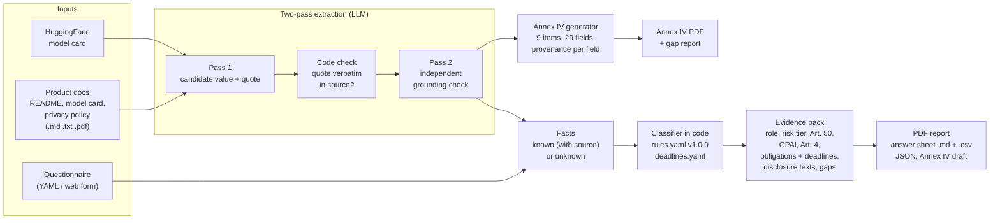

# AI Act Compliance Copilot

EU AI Act tooling with two parts: an **Annex IV technical documentation generator** that grounds every field in the source artifact, and an **AI Act evidence pack** that turns a SaaS team's product docs or a short questionnaire into a classification, an obligations checklist with deadlines, and ready-to-send answers for customer questionnaires.

[](https://github.com/AdityaShekhawat0504/ai-act-compliance-copilot/actions/workflows/ci.yml)

## Why it matters

B2B SaaS companies that ship AI features to EU customers now get AI Act questionnaires from enterprise procurement: what is your role, is it high-risk, how do you meet Article 50, which models do you use. Answering them means reading Regulation (EU) 2024/1689, mapping your product onto it, and finding evidence in your own docs. LLM-only tools make this worse because they invent facts and classifications that nobody can check.

This project keeps the LLM away from decisions. The LLM may only extract facts, every fact needs a quote that code finds verbatim in the source, and classification is done by fixed, versioned rules in code.

## How it works



**Annex IV generator (v1).** For each of the nine Annex IV items, Pass 1 returns `FieldCandidate{value, found_in_source}` via structured outputs. Pass 2 is the only code path that can mark a field `filled`: it makes its own grounding-check LLM call against the raw source and attaches a `Provenance` record. Ungrounded values go to the gap report. 18 LLM calls per document (9 items x 2 passes).

**Evidence pack (v2).** Facts come from two places:

1. **Documents**, through the same two-pass pipeline. Pass 1 asks for a value and a verbatim quote per fact. Code checks that the quote is really in the document (only whitespace and curly quotes are normalised) before any second LLM call. Pass 2 reuses the existing `validate_grounding`. A fact is `known` only if both checks pass; otherwise it stays `unknown`.
2. **A questionnaire** (YAML file or the web form). Answers are self-declared. An answer can cite a quote from a document; the quote is verified the same way and dropped with a note if it is not found.

The classifier then evaluates `src/evidence_pack/data/rules.yaml` in code: role (Art. 3(3), 3(4), 25), prohibited practices (Art. 5), high-risk (Annex III areas, Art. 6(3) derogation, Annex I products), Article 50 triggers (chatbot, synthetic content, emotion recognition / biometric categorisation, deepfakes, AI text on public-interest matters), GPAI use and AI literacy (Art. 4). Unknown inputs are treated conservatively (an unanswered Art. 6(3) derogation keeps the system high-risk) and listed as gaps. All dates live in `src/evidence_pack/data/deadlines.yaml`.

## Results

### Annex IV generator: 10-model benchmark

Benchmarked on 10 HuggingFace models with public model cards across diverse domains (NLP, vision, audio, biomedical, content moderation, embeddings, sentiment, summarization).

| Metric | Two-pass system | LLM-only baseline |
|---|---|---|
| Mean completeness | 28% | 46% |
| Mean required-field completeness | 28% | 47% |
| Mean fields per document (of 29) | 8.2 | 13.4 |
| **Fields failing the grounding check** | **0% (by design)** | **about 1 in 3** (31% and 37% across two runs) |
| Mean time per document | 57s | 32s |
| Estimated cost per document | $0.0167 | $0.0084 |

About 1 in 3 fields populated by the LLM-only baseline fail the grounding check: 31% in one run and 37% in the other, so the figure moves by several points between runs and should not be read more precisely than that. The other rows are from the 37% run. The two-pass 0% is by design, not a measured result: the rate counts filled fields that fail the grounding check, and Pass 2 is the only code path that can mark a field as filled, so the two-pass system scores 0% by construction. It does not measure how often the grounding check itself is wrong.

28% completeness is the honest ceiling for public model cards. Items 5 (risk management, Art. 9), 8 (declaration of conformity, Art. 47) and 9 (post-market monitoring, Art. 72) describe internal processes that do not exist on HuggingFace; items 6 and 7 are similarly absent. The baseline's failure rate ranges from 0% on `facebook/bart-large-cnn` to 62% on `sentence-transformers/all-MiniLM-L6-v2`; the two-pass system rejects ungrounded fields whatever the input quality. Reproduce with `compliance-copilot benchmark` (writes to `benchmark/results/`, gitignored).

### Evidence pack: classification eval

`eval/systems/` holds 15 fictional systems (helpdesk chatbot, CV screening, credit scoring, deepfake-capable image generator, workplace emotion recognition, news auto-writer with and without editorial review, Art. 6(3) derogation with and without profiling, Annex I medical device component, foundation model lab, white-label proctoring, and more), each with hand-written expected labels. `python eval/run_eval.py` runs them offline through the questionnaire path:

| Field | Accuracy |
|---|---|
| role | 100% (15/15) |
| risk_tier | 100% (15/15) |
| art50_triggers | 100% (15/15) |
| gpai_use | 100% (15/15) |
| ai_literacy | 100% (15/15) |

Read this as a regression check, not as validation: the expected labels and the rules were written by the same person from the same reading of the Act, so 100% shows the code does what the rules say, not that the rules are legally right. CI fails if any field drops below 100%. The eval also does not cover LLM extraction quality; that needs real documents and an API key.

### Demo

The fictional company in `examples/brightloop/` (an HR SaaS with a candidate chat assistant, an AI job ad writer and AI shortlist ranking) goes from questionnaire plus three docs to a 6-page PDF report offline. Output of `evidence-pack demo --as-of 2026-11-03`: provider and deployer, high-risk (Annex III point 4, employment), Art. 50(1) and 50(2) triggered, third-party GPAI, 14 obligations, 10 gaps, and an Annex IV draft with 11 of 29 fields filled (38%), each with its source quote.

### Tests

289 tests (114 for the Annex IV generator, 175 for the evidence pack). Every classification and obligation rule has a test, and a meta-test fails if a rule is added without one. All LLM calls are mocked; no test needs network or an API key.

## Quickstart

```bash
git clone https://github.com/AdityaShekhawat0504/ai-act-compliance-copilot.git
cd ai-act-compliance-copilot
uv sync

# Evidence pack, fully offline: fictional demo company -> output/brightloop/
uv run evidence-pack demo
#   evidence_pack.pdf, questionnaire_answers.md, questionnaire_answers.csv,
#   evidence_pack.json, annex_iv.pdf, annex_iv.json

# Your own system: start from a blank questionnaire
uv run evidence-pack template > my_system.yaml
uv run evidence-pack build -q my_system.yaml -o output/my_system

# Extract facts from your docs with the two-pass LLM pipeline
export OPENAI_API_KEY="sk-..."
uv run evidence-pack build -d README.md -d privacy_policy.pdf --llm -o output/my_system

# Web UI (Streamlit is not a locked dependency, uv pulls it in for this command)
uv run --with streamlit streamlit run app/streamlit_app.py

# Annex IV generator from a HuggingFace model card
uv run compliance-copilot generate google/gemma-2b -o output/

# Tests, lint, eval
uv run pytest
uv run ruff check .
uv run python eval/run_eval.py
```

`compliance-copilot report output/<name>.annex_iv.json` re-runs the gap analysis without API cost. `compliance-copilot benchmark` re-runs the 10-model benchmark (about 30 minutes, about $0.20 in OpenAI tokens).

## Tech stack

Python 3.11, uv, Pydantic v2, instructor + OpenAI (gpt-4o-mini), PyYAML, reportlab (PDF output), pypdf (PDF input), huggingface_hub, typer and argparse (CLIs), Streamlit (UI), pytest, ruff, GitHub Actions.

## Project structure

```
src/
  annex_iv/          Annex IV schema (9 items, 29 fields, provenance) + regulation text
  ingestion/         HuggingFace model card loader (MLflow, eval reports planned)
  extraction/        Two-pass pipeline: Pass 1 candidates, Pass 2 grounding check
  gap_analysis/      Annex IV completeness and gap report
  output/pdf.py      Annex IV PDF
  cli.py             compliance-copilot CLI (generate, report, benchmark)
  evidence_pack/
    data/rules.yaml      versioned classification and obligation rules (article refs)
    data/deadlines.yaml  every application date, in one place
    facts.py             fact registry and evidence model
    documents.py         .md/.txt/.pdf loading, verbatim quote check
    extract.py           document facts via the two-pass pipeline
    questionnaire.py     offline structured input
    rules.py, classify.py  condition evaluator and classifier (no LLM)
    report.py            obligations, gaps, disclosures, customer answers, Annex IV draft
    export.py            PDF, Markdown, CSV, JSON
    cli.py               evidence-pack CLI
app/streamlit_app.py   web UI
examples/brightloop/   fictional demo company (docs + questionnaire)
eval/                  15 fictional systems + run_eval.py
benchmark/             10-model Annex IV benchmark
tests/                 289 tests, LLM mocked
docs/ARCHITECTURE.md   components, data flow, design decisions
```

## Limitations and next steps

- **Not legal advice.** The rules cover the main decision points of the Act, not every exception (for example, Art. 2 exclusions, Art. 27 for public bodies, sector-specific Annex I procedures). The output is a starting point for counsel, and says so on every page.
- **Dates need re-checking.** `deadlines.yaml` reflects the high-risk and Art. 50(2) dates as amended by the 2026 Digital Omnibus on AI. Verify them against the Official Journal before relying on them.
- **The eval is a self-consistency check.** Labels were written alongside the rules. An independent set labelled by a lawyer is the next step.
- **Extraction quality is not benchmarked for v2.** The quote check rules out invented quotes, but not a real quote that supports the wrong answer; Pass 2 is the only guard there. Measuring this needs a labelled document set.
- **Annex IV completeness stays low from public docs.** Items 5 to 9 need internal process documents. Multi-artifact ingestion (MLflow, eval reports) is planned.
- **English only**, single system per run, no persistence or multi-user features in the UI.

## Author

**Aditya Singh Shekhawat** -- B.Sc. Applied Artificial Intelligence at Technische Hochschule Rosenheim, focused on RegTech, AML, and AI governance tooling. [LinkedIn](https://www.linkedin.com/in/aditya-singh-shekhawat/).

## License

MIT. This is a portfolio project, not legal advice, and not a substitute for professional regulatory assessment under Regulation (EU) 2024/1689. The example company and all eval systems are fictional.
