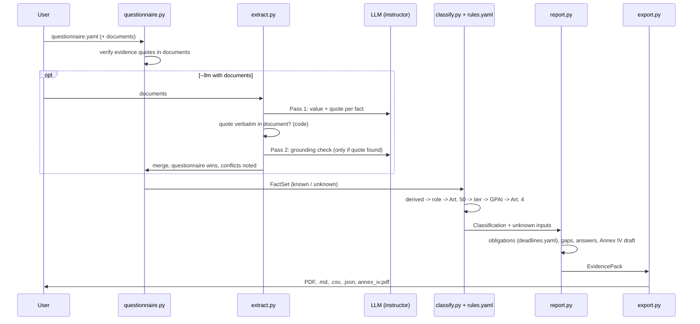

# Architecture

Two products share one extraction core:

- **Annex IV generator** (v1): HuggingFace model card -> provenance-tracked Annex IV document, gap report, PDF.
- **Evidence pack** (v2): product docs and/or a questionnaire -> facts -> rule-based classification -> obligations, disclosures, gaps, customer answers, Annex IV draft -> PDF, Markdown, CSV, JSON.

## Components

| Component | Path | Responsibility |
|---|---|---|
| Annex IV schema | `src/annex_iv/schema.py` | Pydantic models for 9 items / 29 fields. `DocumentedField` refuses `status="filled"` without `Provenance`. |
| Ingestion | `src/ingestion/` | `NormalisedArtifact` (structured content + raw text). HuggingFace model card loader. |
| Two-pass extraction | `src/extraction/` | Pass 1: `FieldCandidate` per field via instructor. Pass 2: `validate_grounding`, an independent LLM check against raw text; the only path to `filled`. |
| Gap analysis | `src/gap_analysis/analyzer.py` | Deterministic completeness scores and missing-field list with regulation text. |
| Annex IV PDF | `src/output/pdf.py` | Cover, 9 item sections, Appendix A (gaps), Appendix B (provenance). |
| Facts | `src/evidence_pack/facts.py` | Registry of ~45 facts (bool, text, list). `Fact` refuses `known` from a document without a verified quote. |
| Documents | `src/evidence_pack/documents.py` | Load .md/.txt/.pdf (pypdf). `verify_quote`: verbatim match after whitespace and curly-quote normalisation, minimum 12 characters. |
| Fact extraction | `src/evidence_pack/extract.py` | Pass 1 asks for value + quote per fact. Code quote check. Pass 2 = existing `validate_grounding`. Merges documents; questionnaire overrides. |
| Questionnaire | `src/evidence_pack/questionnaire.py` | Offline structured input; verifies optional evidence quotes against listed documents. |
| Rules | `src/evidence_pack/data/rules.yaml` | Versioned. Catalogues (Art. 5 practices, Annex III areas), derived values, roles, Art. 50 triggers with disclosure templates, risk tiers, GPAI, Art. 4, obligations with article, party, deadline key and evidence fact. |
| Deadlines | `src/evidence_pack/data/deadlines.yaml` | Every application date, versioned, with a re-check-against-the-Official-Journal note. |
| Evaluator + classifier | `src/evidence_pack/rules.py`, `classify.py` | Small condition language (`eq`, `nonempty`, `intersects`, `all`, `any`, `not`). Pure functions, no LLM. |
| Report | `src/evidence_pack/report.py` | Obligations with resolved deadlines and evidence status, gaps, 12 customer answers, Annex IV draft for high-risk providers. |
| Export | `src/evidence_pack/export.py` | reportlab PDF, Markdown + CSV answer sheet, JSON; reuses `output/pdf.py` for the Annex IV draft. |
| Interfaces | `src/cli.py`, `src/evidence_pack/cli.py`, `app/streamlit_app.py` | typer CLI (v1), argparse CLI (v2), Streamlit UI (v2). |
| Eval | `eval/` | 15 fictional systems with expected labels; `run_eval.py` prints per-field accuracy. |

## Data flow (evidence pack)

Classification order matters: derived values (`is_provider`, `annex_iii_derogation`, `is_high_risk`, ...) are evaluated top to bottom, then role, then Art. 50 triggers (which feed `transparency_triggered`), then the risk tier (first match wins: prohibited, high-risk, limited, minimal), then GPAI and AI literacy, then obligations.

## Key design decisions

1. **The LLM never classifies.** It only extracts facts. Classification is a pure function of facts and `rules.yaml`, so the same answers always give the same result, every result has an article reference, and the eval can run offline in CI.
2. **Quotes are checked by code, not by a second model.** The verbatim check runs before Pass 2, so an invented quote is rejected without spending a call, and nothing becomes `known` on the LLM's word alone. Pass 2 still runs on real quotes to catch quotes that do not support the value.
3. **Unknown is a first-class value.** The evaluator never lets an unknown satisfy a condition, and reports which unknowns could have changed the result (a branch already settled by known facts does not report its unknowns). Rules are written so the conservative case wins: an unanswered Art. 6(3) derogation keeps a system high-risk; unanswered editorial review keeps the Art. 50(4) text trigger on.
4. **One rules file, one dates file.** Lawyers and engineers review one YAML each. Both carry a version printed on every report. A test fails if any rule lacks an article, names an unknown fact or deadline, or has no test case.
5. **Triggers are feature-based, obligations are role-based.** Art. 50 triggers describe what the system does; whether the company must act depends on its role (50(1)/(2) for providers, 50(3)/(4) for deployers). This is why a provider of a deepfake generator sees the trigger but not the deployer's labelling duty.
6. **Reuse v1 for v2.** The fact extractor calls the existing `validate_grounding`, and the Annex IV draft is a normal `AnnexIVDocument` with `Provenance`, so the existing gap analyzer and PDF generator work on it unchanged.
7. **Few dependencies.** The core runs on Pydantic, PyYAML, reportlab and pypdf. The v2 CLI uses argparse. Streamlit is pulled in only for the UI (`uv run --with streamlit`), so the lock file stays small.

## Testing

- All LLM calls are mocked (`tests/test_extraction.py`, `tests/test_ep_inputs.py` use fake instructor clients).
- `tests/test_ep_rules.py` has a case for every derived value, role, trigger, tier, GPAI rule and obligation, plus a meta-test that compares the case list with `rules.yaml`.
- `tests/test_ep_outputs.py` runs the demo end to end and checks the PDF text with pypdf.
- CI (`.github/workflows/ci.yml`): `uv sync --locked`, ruff, pytest, Streamlit smoke test, eval with `--fail-under 1.0`, demo run. No secrets.
